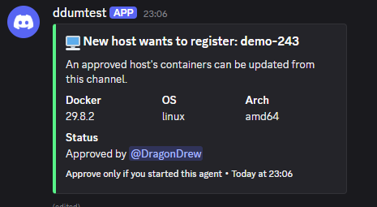
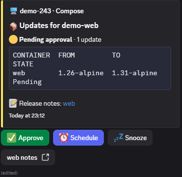
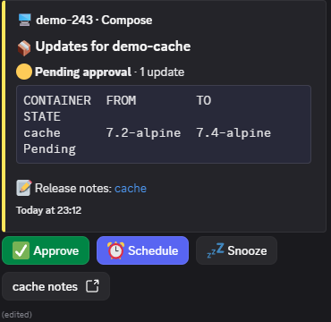
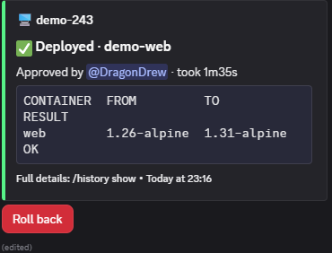
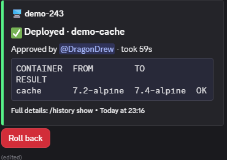
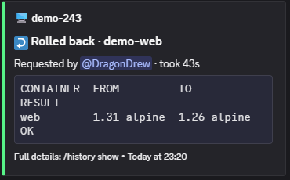
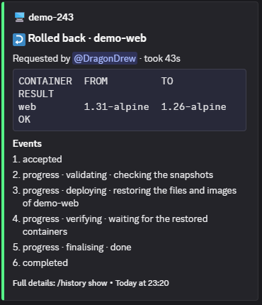

# ddum: Docker updates, approved from Discord

**ddum (Discord Docker Update Manager) finds new versions of your container images, posts each update to a private Discord channel, and deploys what you approve, or what you've told it to deploy automatically. Every deploy is verified, and each one can be rolled back in one click.** There's no web UI. Discord is the whole interface.

If you run a few Docker hosts with Compose or Portainer stacks, you probably know the two usual options. Watchtower updates everything automatically, which is fine until something breaks at 3am. Diun tells you an update exists, and then you still SSH in to do it. ddum sits between them: manual review by default, automatic deploys wherever you choose to allow them, and a rollback button when something goes wrong.

These screenshots are from a demo on one host: a bot and an agent, plus two stacks on older images, `demo-web` (nginx 1.26) and `demo-cache` (redis 7.2). The server, channel and bot are made up for the demo.

---

## The pitch in one screen

- **A central bot** checks registries (digest and tag) on a schedule and when you ask. Each update becomes a card in your channel.
- **A small agent on each host** finds your Compose and Portainer stacks, reports their state, and applies the updates.
- **Manual by default.** Nothing deploys until you approve it, unless you set a policy to automatic at the level you choose.
- **Approve means exactly that.** A deploy uses the digest you approved, and it checks that the new containers are running, healthy and on that digest before it reports success.
- **Rollback is one click**, and automatic rollback is on by default for automatic updates. Before any change, the agent pins the old images, and a rollback puts back only the image tags, so later edits to your files stay.
- **Your files stay yours.** For Compose, ddum changes only the image tag line, and checks first that recreating a container won't change its mounts or variables. For Portainer, it works through Portainer's API.

---

## Features

### Finding updates
- Checks registries for new digests of the tags you run, and for newer versions where the tag follows a version scheme.
- You choose how far an update may jump: `pinned`, `same-minor`, `same-major` or `any`.
- Shows each container's tracking mode, and why a container can't be tracked.
- Links to release notes where the image publishes them.
- Checks on a set interval, and on demand with `/update check`.

### Approving and deploying
- **Approve** on the card, or `/update approve`.
- **Schedule** an approved update for a whole hour in the next 24, such as 03:00. The deploy uses the digest you approved, even if the tag moves before then.
- **Snooze** an update to be asked about later. A snoozed update isn't deployed automatically either.
- **Update groups** deploy containers from different stacks together, and roll them back as one.
- **Verification** after every deploy: the container must be running, on the approved digest, and healthy if it has a health check, and the other containers in the stack must still be running. A failed check is reported as a failure, with the reason.

### Automatic updates (opt-in)
- Set a policy to `automatic` at any level: global, host, stack, group or container. Each field inherits from the level above unless you override it, and `/policy show` shows which level set each one.
- The policy modes are `manual` (the default), `automatic` and `ignore`. A container can also be labelled `ddum.ignore=true`.
- **Automatic rollback** is on by default for automatic updates, so a failed automatic deploy rolls itself back.
- An automatic deploy waits while a snooze is active, and it's paused by maintenance mode.
- A group with a mix of `manual` and `automatic` members is held, and the bot says which members conflict. Give the group one policy to deploy it automatically.
- The bot itself is never updated automatically, and neither is any protected container.

### Rolling back
- Every deploy takes a snapshot first. **Roll back** on its result, or `/rollback run`.
- Rollback restores the same services the deploy changed, and only while the snapshot is still there. The agent keeps the last three deployments of each stack by default.
- `/history show` lists operations and the steps each one went through.

### Keeping control
- **Policies** per host, stack, group or container, with `/policy show` for the effective setting.
- **Protected containers**, such as the ddum agent and Portainer, are never updated or recreated by ddum. Their updates show as "Held: protected", and you update them by hand.
- **Maintenance mode** pauses notifications and automatic deploys while you work on a host.
- **Failed automatic deploys aren't retried.** The update waits for you, and a newer release deploys automatically again.
- **Warnings** appear on a result when a deploy also applied a change to the stack's configuration, so you can see what else changed.
- **Renamed or moved stacks** are matched to their old identity, so policies and history stay with the workload. A merge needs your confirmation.
- Only the Discord users you list can run commands or click approve. Secrets are never accepted through Discord.

### Running it
- **Compose** stacks are updated by editing the image tag and running `docker compose` through the agent. **Portainer** stacks are updated through Portainer's API, so the agent doesn't need their files.
- **Standalone containers** started with `docker run` are listed and checked, but ddum never deploys them. You update those by hand.
- A single Compose project on one host, or a bot plus agents across several hosts.
- Agents only do a fixed set of actions. They never run a command built from text the bot sent, and they only edit files under the folders you allow.
- The bot updates itself too, but only through its own approval, which restarts the bot.
- Private registries are supported. The bot and any agent that pulls private images need a Docker login for them.
- The state lives in one SQLite file, which has a `backup` command.
- Runs on `linux/amd64` and `linux/arm64` hosts. Each agent has its own key, and the bot pins it. The agent-to-bot traffic is signed but not encrypted, so keep it on a private network.

---

## What it isn't

- **Not a dashboard.** Discord is the whole interface.
- **Not a Portainer replacement.** It works alongside Portainer, through its API.
- **Not for standalone containers.** It checks them, but you update them by hand.

---

## The demo

### A new host asks to join

Nothing runs on a new host until someone approves it in Discord.

### An update is waiting for approval

Each update is its own card, so you can approve one without touching the others.

### After approval: the deploy result

The card changes in place from "Pending approval" to "Deployed", and keeps its **Roll back** button.

### Rolling back

A rollback goes back to the image the container had before the deploy. It changes only the image tags in your files.

### History

`/history show` replies with each operation's result and the steps it went through. A rollback uses the same steps as a deploy.

---

## Things ddum holds back

Some updates are never applied from Discord. Their cards say why:

- **Held: protected.** A component such as ddum's own agent, or the Portainer agent, has to be updated by hand before it can be re-checked.
- **Held: manual update required.** The stack lives outside the folders ddum may edit (`COMPOSE_ALLOWED_ROOTS`), or the container is standalone.
- **Held: policy conflict.** A group has members with different modes.
- **Refused: would change the stack.** Recreating a container would change its mounts or variables, for example because the stack relies on your shell's environment. Nothing is changed, and the card names what would differ. Give the agent the value it needs, as its `STACK_ENV_` settings describe.
- **Refused: cannot load the stack.** Compose can't load the stack from inside the agent, usually because a file it uses isn't mounted there. Nothing is changed, and the card names the file.

These show up in the same channel, with no Approve button. A refused deploy changes nothing, so you can fix the cause and approve again.
